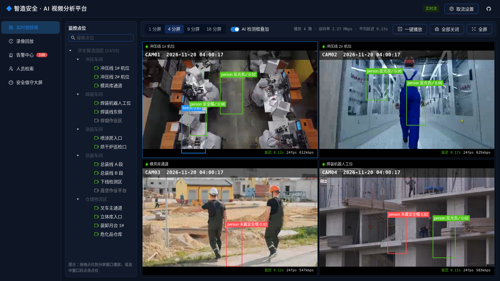
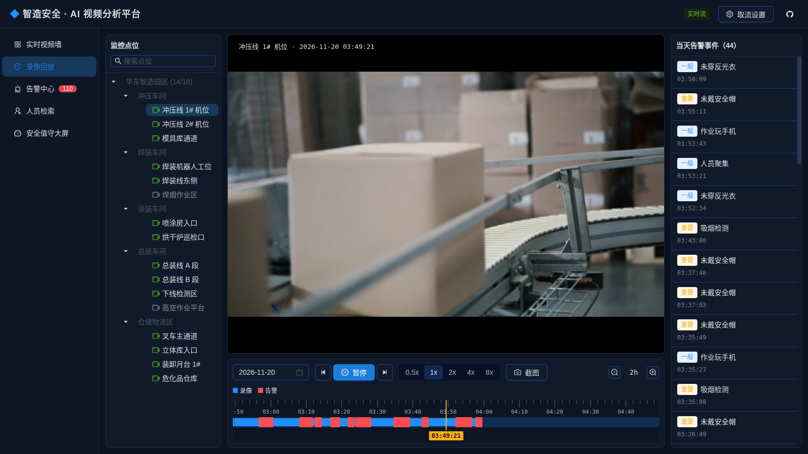
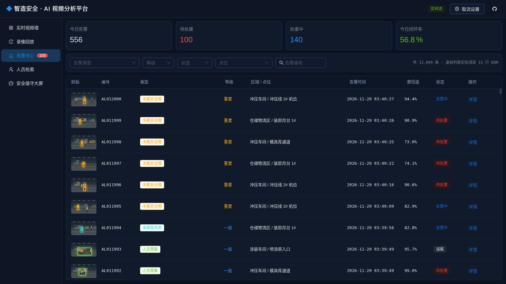
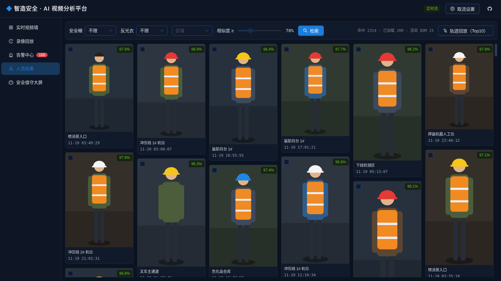
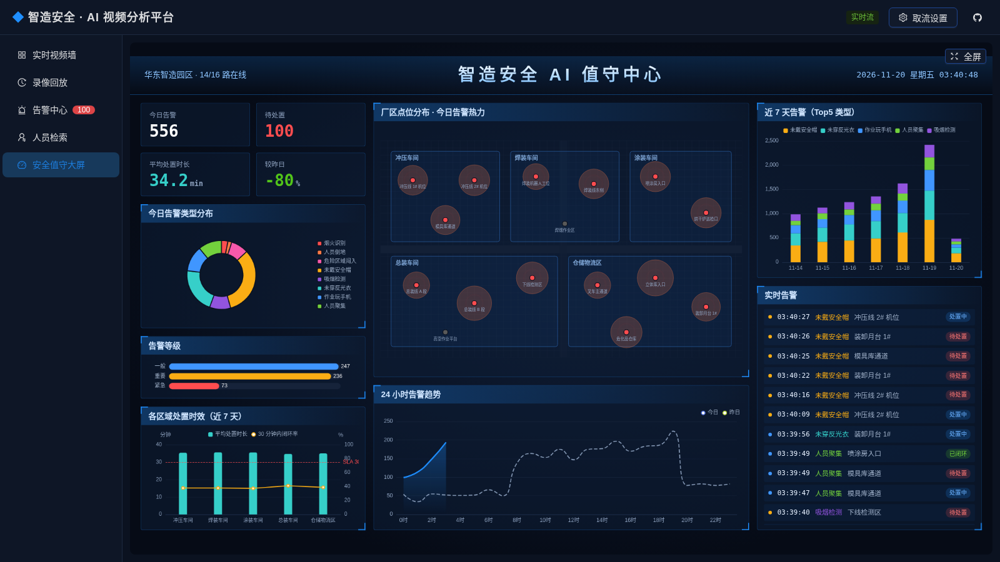

# 智造安全 · AI 视频分析平台（前端 Demo）

在线演示：https://nostalgiau.github.io/ai-video-monitor-demo/ （演示模式）

面向制造业安全生产场景的 AI 视频分析平台 Web 端演示项目，覆盖 **实时视频墙、录像回放、告警中心与处置流程、人员检索与轨迹回放、安全值守大屏**。
视频使用真实工厂/工地场景素材（FFmpeg 循环推流模拟 8 路摄像头），告警与抓拍为本地模拟数据，重点展示流媒体接入、播放器生命周期管理、大数据量渲染和可视化能力。



## 技术栈

| 领域 | 选型 |
|---|---|
| 框架 | React 19 + TypeScript + Vite，React Router（Hash 路由，按页面懒加载） |
| UI | Ant Design 6（暗色主题） |
| 直播 | mpegts.js（flv.js 后继），HTTP-FLV / WS-FLV，MSE + Worker |
| 回放 | hls.js（HLS VOD） + Canvas 自绘时间轴 |
| 状态 | Zustand（取流配置持久化到 localStorage） |
| 可视化 | ECharts 6、SVG 厂区平面图、Canvas 检测框叠加 |
| 大列表 | @tanstack/react-virtual 虚拟列表、自研虚拟瀑布流 |
| 流媒体 | ZLMediaKit（RTMP/RTSP 接入 → FLV/HLS/WebRTC 分发），FFmpeg 模拟摄像头 |

## 整体链路

```
 摄像头 / NVR ──RTSP/GB28181──┐
 FFmpeg 推 8 路素材 ──RTMP────┼─▶ ZLMediaKit ──WS-FLV / HTTP-FLV──▶ mpegts.js  视频墙（低延迟直播）
                              │               └─HLS──────────────▶ hls.js     录像回放
 算法服务 ──告警事件(WebSocket)─┴────────────────────────────────▶ 告警中心 / 大屏 / 检测框叠加
```

浏览器无法直接播放 RTSP，需要流媒体服务转协议；本项目用 ZLMediaKit 默认规则 `ws://{host}/live/{stream}.live.flv` 拉流。

## 功能与技术要点

### 1. 实时视频墙 `src/pages/VideoWall.tsx` `src/components/VideoPlayer`
- 1 / 4 / 9 / 16 分屏，点位树 **拖拽上墙**、窗口间拖拽交换、双击放大、全屏、单窗口截图。
- **低延迟**：关闭 stash buffer、开启 Worker；实时计算 `buffered.end - currentTime`，延迟 > 1.2s 时 1.25 倍速追帧，> 2.5s 直接跳到缓冲区末尾。
- **资源回收**：`IntersectionObserver` + `visibilitychange`，窗口滚出可视区或页面切到后台时 `destroy()` 播放器、断开连接，回来后重新拉流，避免多路解码导致内存/CPU 飙升。
- **断线重连**：指数退避（1s → 15s），每路显示延迟 / 帧率 / 码率 / 丢帧。
- **连接数**：默认用 WS-FLV，规避浏览器同域 HTTP/1.1 最多 6 个长连接的限制（HTTP-FLV 16 路会卡住）。
- Canvas 叠加 AI 检测框（人员、安全帽、叉车等）。

### 2. 录像回放 `src/pages/Playback.tsx` `src/components/Timeline.tsx`
- Canvas 自绘 24h 时间轴：录像段 / 告警段着色，**拖拽平移、滚轮缩放（24h → 20min）**、点击定位，高 DPI 适配。
- 按时间映射到录像片段并 seek，支持 0.5x–8x 倍速、上一段/下一段、告警事件一键跳转、截图。

### 3. 告警中心 `src/pages/AlarmCenter.tsx`
- 12,000 条告警 **虚拟列表**，DOM 只渲染十几行；按类型 / 等级 / 状态 / 点位 / 编号筛选。
- 详情抽屉：抓拍图 + 归一化坐标检测框、置信度、处置流程（待处置 → 派单处置中 → 整改闭环 / 误报）、处置记录、跳转告警前后录像。
- 模拟 WebSocket 实时推送，高等级告警弹窗提醒，新告警行高亮。

### 4. 人员检索 `src/pages/PersonSearch.tsx`
- 按安全帽 / 反光衣颜色、区域、相似度检索，3,000 条结果分页加载。
- **虚拟瀑布流**：根据宽高比预计算布局（最短列优先），只渲染视口上下 600px 内的卡片，图片 `loading="lazy"`。
- 多选结果按时间串联，在厂区平面图上做 **轨迹回放**。

### 5. 安全值守大屏 `src/pages/Dashboard.tsx`
- 1920×1080 设计稿等比缩放，适配任意分辨率，支持全屏。
- 告警类型分布、等级、各区域处置时效（SLA 线）、厂区点位告警热力、24h 趋势（今日 vs 昨日）、近 7 天 Top5、实时告警滚动。

## 本地运行

需要 Node 20+。如需真实视频流，再准备 Docker。

```bash
npm install

# 方式一：只看前端（演示模式，用本地 MP4 模拟直播，无需任何后端）
VITE_DEMO_MODE=true npm run dev

# 方式二：完整链路（ZLMediaKit + 8 路 FFmpeg 模拟摄像头）
docker compose up -d   # RTMP :1935, HTTP/WS-FLV :8080
npm run dev            # 顶部「取流设置」可切换 WS-FLV / HTTP-FLV、媒体服务器地址
```

也可以不用 Docker 里的 FFmpeg，本机直接推流：`./scripts/push-streams.sh 127.0.0.1:1935 8`

| 环境变量 | 说明 |
|---|---|
| `VITE_DEMO_MODE` | `true` 时默认演示模式 |
| `VITE_MEDIA_HOST` | 媒体服务器地址，默认 `当前主机:8080` |
| `VITE_REPO_URL` | 顶栏 GitHub 按钮链接 |

## 目录结构

```
src/
  components/   VideoPlayer（播放器+检测框）、Timeline、DeviceTree、FactoryMap、Chart、AlarmSnapshot
  pages/        VideoWall、Playback、AlarmCenter、PersonSearch、Dashboard
  hooks/        useInViewport、useSize
  mock/         设备/告警/录像/抓拍图模拟数据（固定随机种子）
  utils/        取流地址规则、格式化
scripts/        push-streams.sh 模拟摄像头推流
public/cameras  8 路点位视频素材（推流 & 演示模式共用）
public/records  录像回放用 HLS 切片
```

## 部署

推送到 `main` 后 GitHub Actions 会构建（演示模式）并发布到 GitHub Pages（需在仓库 Settings → Pages 中选择 GitHub Actions）。

## 截图

| 录像回放 | 告警中心 |
|---|---|
|  |  |
| **人员检索** | **值守大屏** |
|  |  |

## 素材来源

视频素材来自 [Mixkit](https://mixkit.co/)，已转码为 640×360 H.264，仅用于本个人非商业作品展示，不是真实监控采集数据。
除 1457 号为 Stock Video Free License 外，其余均为 [Mixkit Stock Video Restricted License](https://mixkit.co/license/#videoRestricted)（仅限个人/非商业用途），请勿用于商业项目。

| 用途 | Mixkit 素材 ID |
|---|---|
| 实时点位 cam01–cam08 | 22032、23378、46753、31473、14785、20770、45848、47755 |
| 录像 clip01 | 22032、23378、21795、47755 |
| 录像 clip02 | 46753、31473、1457、24127 |
| 录像 clip03 | 14785、20770、45848、23551 |
